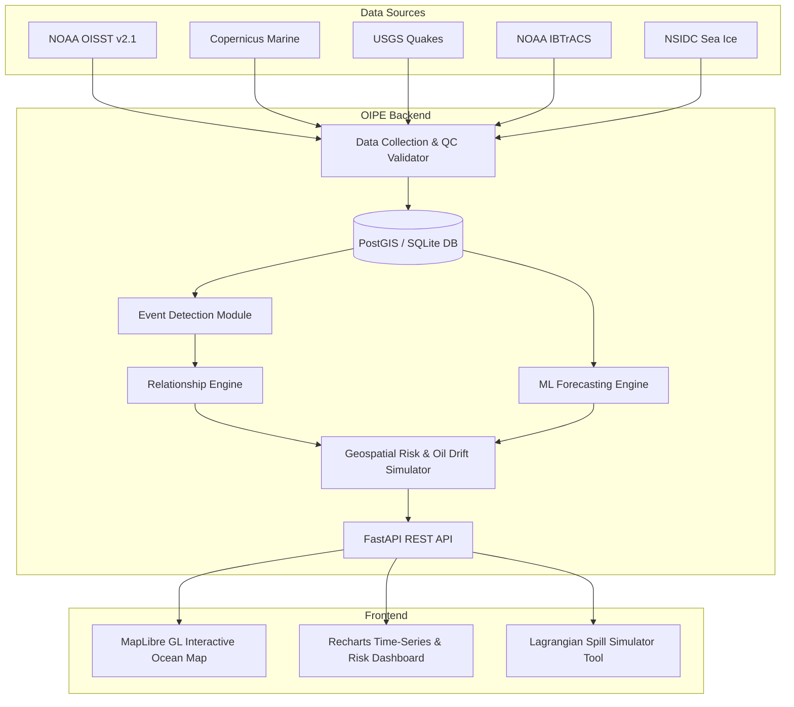

# BLUECHAIN: AI-Powered Ocean Behaviour and Impact Prediction System

[](LICENSE)
[](https://python.org)
[](https://maplibre.org)
[](https://fastapi.tiangolo.com)

BLUECHAIN is an end-to-end, marine-only intelligence platform designed to monitor, analyse, and predict oceanic hazards triggered by natural ocean-atmosphere dynamics, climate change, and human maritime activity.

---

## 🌊 Strictly Marine Scope
BLUECHAIN focuses solely on oceanic basins:
- **Target Oceans**: Pacific, Atlantic, Indian, Arctic, Antarctic, Southern Oceans.
- **Strict Boundary**: Terrestrial waters (rivers, freshwater lakes, groundwater, land runoff management, drought) are explicitly rejected by spatial land-mask filtering.

---

## 🚀 Key Capabilities & Modules (OIPE)

1. **Event Detection Engine**:
   - **Marine Heatwaves (MHW)**: Hobday et al. (2016/2018) criteria ($\ge$ 90th percentile SST anomaly for 5+ consecutive days) categorized into *Moderate*, *Strong*, *Severe*, and *Extreme*.
   - **Offshore Subduction Earthquake / Tsunami Risk**: Real-time filtering of marine epicenters ($M \ge 6.5$, depth $< 70$ km).
   - **Tropical Cyclone Track Tracking**: Integration with NOAA IBTrACS.
   - **Harmful Algal Blooms (HAB)**: Z-score chlorophyll anomalies combined with thermal stratification.
   - **Polar Sea-Ice Decline**: NSIDC 1991–2020 baseline deviation tracking.

2. **Data Collection & Ingestion**:
   - Connectors for NOAA OISST v2.1, NOAA Coral Reef Watch, Copernicus Marine Service, USGS Earthquake API, NOAA IBTrACS, NSIDC, and Open-Meteo Marine.
   - Rigorous Quality Control (QC): range bounds, missing values, physical plausibility, unit standardization, and spatial land-mask exclusion.
   - **Sample-Data Mode** (`USE_SAMPLE_DATA=true`): Runs fully offline with bundled historical ocean datasets.

3. **Scientific Relationship Engine**:
   - YAML-configured rules modeling oceanographic interdependencies:
     - High SST + Low Wind $\to$ Elevated MHW & Coral Bleaching Risk.
     - Elevated Chlorophyll + Warm SST $\to$ HAB / Deoxygenation Risk.
     - Acidification stress from dropping ocean pH.
     - Warm sea surface anomalies $\to$ Cyclone rapid intensification risk.

4. **Machine Learning Forecasting**:
   - XGBoost and Persistence baseline forecasting SST anomalies at 7, 14, and 30-day horizons.
   - Monthly sea-ice extent projections.
   - Time-series validation split preventing data leakage, tracking MAE/RMSE.

5. **Geospatial Risk & Lagrangian Spill Simulator**:
   - Composite gridded **Ocean Risk Index (0–100)** delivered as GeoJSON.
   - **72-hour Lagrangian Oil Spill Drift Simulation**: Advection driven by surface currents + 3% wind drift with stochastic diffusion.

---

## 🏗️ Architecture



---

## 🛠️ Quick Start

### 1. Backend Setup
```bash
# Clone the repository
git clone https://github.com/shivbhardwaj009/bluechain.git
cd bluechain

# Setup environment
cp .env.example .env

# Install dependencies
pip install -r backend/requirements.txt

# Start backend server
python -m uvicorn backend.app.main:app --host 0.0.0.0 --port 8000 --reload
```

### 2. Frontend Setup
```bash
cd frontend
npm install
npm run dev
```

### 3. Docker Deployment
```bash
docker compose up --build
```
Access the web dashboard at `http://localhost:5173` and API documentation at `http://localhost:8000/docs`.
